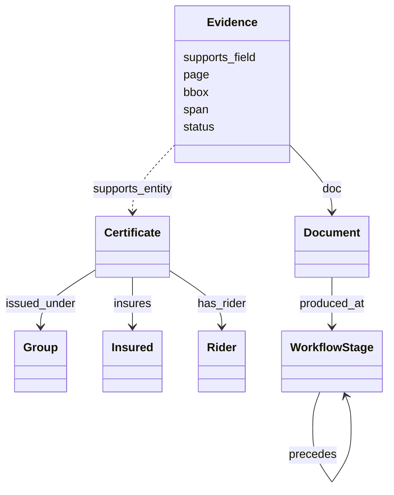

# The VeriDoc-KG ontology

A small ontology for one worksite group-life case: the employer's group policy, one employee's
certificate, the insured employee, a rider, and the documents the values were read from.
It is deliberately minimal: it holds the fields the 22-column payroll deduction file needs, the fields the
verifier's cross-checks need, and the provenance of every value.

| File | Content |
|---|---|
| `ontology.ttl` | Classes and properties (RDFS/OWL). Generated by `python -m veridoc.ontology`. |
| `shapes.ttl` | SHACL shapes: datatypes, ranges, one value per property, date order. |
| `DATA/processed/kg/kg.ttl` | The individuals of the case and their evidence (generated by the pipeline). |

Namespaces: `ex:` = `http://veridoc.example/onto#` (classes, properties), `case:` = `http://veridoc.example/case/1#` (individuals).

`python -m veridoc.ontology --check` fails if the graph, the shapes or the deduction mapping use a class or
property that is not declared here, if a property is used on an individual outside its domain or range,
or if an individual has two classes.

## Classes and relations

The seven classes are pairwise disjoint. `supports_entity` points at any Group, Certificate, Insured or
Rider individual (drawn once above).

## Properties by class

Range `xsd:string` unless stated. "Verified value found in" lists the documents where the pipeline found
a value that passed every check on this document set; "none" means the value is redacted or blank there.

### Group

The employer (group policyholder) that sponsors the worksite plan.

| Property | Range | Label printed on the documents | Constraint (SHACL) | Verified value found in |
|---|---|---|---|---|
| `ex:group_name` | xsd:string | Group Name / Group Policyholder |  | group proposal |
| `ex:group_number` | xsd:string | Group Number |  | none in this document set |
| `ex:group_street` | xsd:string | PO Box or Street |  | master application |
| `ex:group_state` | xsd:string | State or Country | two capital letters | master application |
| `ex:situs_state` | xsd:string | Situs State | two capital letters | group proposal |
| `ex:eligible_employees` | xsd:integer | Number of eligible employees/members | >= 1 | master application |
| `ex:proposed_effective_date` | xsd:date | Proposed effective date |  | none in this document set |
| `ex:signature_date` | xsd:date | Date (signature block) |  | none in this document set |
| `ex:presented_by` | xsd:string | Presented By |  | group proposal |
| `ex:proposal_date` | xsd:date | Date (proposal cover) |  | group proposal |

### Certificate

One employee's certificate of coverage under the group policy.

| Property | Range | Label printed on the documents | Constraint (SHACL) | Verified value found in |
|---|---|---|---|---|
| `ex:face_amount` | xsd:decimal | Face Amount | > 0 | employee certificate |
| `ex:certificate_number` | xsd:string | Certificate Number |  | none in this document set |
| `ex:certificate_date` | xsd:date | Certificate Date | before maturity_date | employee certificate |
| `ex:maturity_date` | xsd:date | Maturity Date |  | employee certificate |
| `ex:risk_class` | xsd:string | Risk Class |  | employee certificate |
| `ex:plan` | xsd:string | Plan |  | employee certificate |
| `ex:min_paidup_amount` | xsd:decimal | Minimum Paid-Up Life Insurance Amount | > 0 | employee certificate |
| `ex:premium_frequency` | xsd:string | Initial Premium Payment Frequency | one of Weekly, Bi-Weekly, Semi-Monthly, Monthly, Quarterly, Annual | employee certificate |
| `ex:loan_interest_rate` | xsd:decimal | Loan Interest Rate | 0 to 25 | employee certificate |
| `ex:annual_premium` | xsd:decimal | Annual Certificate Premium (excluding Riders) | > 0 | employee certificate |
| `ex:payroll_frequency` | xsd:string | Your &lt;frequency&gt; Premium | one of Weekly, Bi-Weekly, Semi-Monthly, Monthly, Quarterly, Annual | employee certificate |
| `ex:payroll_deduction_amount` | xsd:decimal | Your &lt;frequency&gt; Premium (amount) | > 0 | employee certificate |

### Insured

The employee covered by a certificate.

| Property | Range | Label printed on the documents | Constraint (SHACL) | Verified value found in |
|---|---|---|---|---|
| `ex:insured_name` | xsd:string | Insured |  | none in this document set |
| `ex:date_of_birth` | xsd:date | Date of Birth |  | employee certificate |
| `ex:issue_age` | xsd:integer | Issue Age | 18 to 75 (eligibility rule in the master application) | employee certificate |
| `ex:ee_city` | xsd:string | City |  | employee certificate |
| `ex:ee_state` | xsd:string | State | two capital letters | employee certificate |
| `ex:ee_zip` | xsd:string | Zip Code | five digits | employee certificate |
| `ex:date_of_hire` | xsd:date | Date of Hire |  | employee certificate |
| `ex:annual_salary` | xsd:decimal | Annual Salary/Compensation | >= 0 | employee certificate |
| `ex:job_title` | xsd:string | Job Title/Occupation |  | none in this document set |

### Rider

An optional benefit attached to a certificate (here: accidental death benefit).

| Property | Range | Label printed on the documents | Constraint (SHACL) | Verified value found in |
|---|---|---|---|---|
| `ex:rider_date` | xsd:date | Rider Date | before rider_termination_date | employee certificate |
| `ex:rider_benefit_amount` | xsd:decimal | Benefit Amount | > 0 | employee certificate |
| `ex:rider_annual_premium` | xsd:decimal | Annual Premium (rider) | > 0 | employee certificate |
| `ex:rider_termination_date` | xsd:date | Termination Date |  | employee certificate |

### Document, WorkflowStage

`ex:title` (Document), `ex:produced_at` (Document to WorkflowStage), `ex:precedes` (stage order):
process map, quote, master application, enrollment, policy, certificate.

## Provenance model

A property value is never asserted without evidence. For every value on an individual there is at least
one `ex:Evidence` individual with:

| Property | Meaning |
|---|---|
| `ex:supports_entity`, `ex:supports_field` | which individual and which property the evidence supports |
| `ex:doc`, `ex:page` | the document and the 1-based page |
| `ex:bbox` | bounding box in PDF points (the UI draws it on the page) |
| `ex:span` | the text as read from the page |
| `ex:status` | `verified` (every check passed) or `human_verified` (restored by a reviewer) |

Evidence is a separate individual, not RDF reification or RDF-star, so the same structure loads into
Neo4j unchanged: `(:Evidence)-[:SUPPORTS]->(entity)` and `(:Evidence)-[:FROM]->(:Document)`.
A value with several supporting pages has several Evidence individuals (the certificate date has four).
Quarantined values are not in the graph at all; they stay in `facts.json` with their reason code.

## Identity: canonical forms and keys

Identity is settled by fixed rules before any similarity matching (`CODE/veridoc/keys.py`).

**Canonical forms.** Every value is compared in one form: dates `YYYY-MM-DD`, money `0.00`, states two
letters, frequencies from a fixed list, ids upper case, names through `name_key` (case-folded, punctuation
removed, `&` = `and`, leading "The" and trailing legal suffixes such as Inc, LLC, Corp dropped).
So "Acme Widgets, Inc." and "ACME WIDGETS INC" are the same name, and "$1,000.00" and "$1000" the same amount.

**Keys.** Each Group, Insured, Certificate and Rider gets `ex:canonical_key`, declared as an OWL 2 key
(`owl:hasKey`), and `ex:key_basis`, which says which rule built it. The first rule whose fields are all present wins:

| Class | Key rules, in order |
|---|---|
| Group | group number; else name + state |
| Insured | keyed hash of the employee id; else name + date of birth |
| Certificate | certificate number; else group key + insured key + certificate date |
| Rider | certificate key + rider date |

When no rule applies, the entity gets no key and is never merged with another. In the de-identified set
only the Group has one (`group:quest|OR`); the certificate number and the insured's name are blacked out.

**Personal identifiers** (SSN, employee id) are never stored: `id_hash` keeps an HMAC-SHA256 with a secret
from `VERIDOC_ID_SECRET` and refuses to run without it.

**Cross-document agreement** compares canonical forms exactly, over the documents that describe the same
individual (proposal and master application for the Group; certificate and employee application for the
Insured and Certificate). The policy specimen (another group's sample) and the proposal's rate illustrations
(example employees) describe other entities, so their values are not conflicts. A truncated or redacted value ("Quest"
against "Quest Benefits") is a conflict sent to review, not a match. Similarity (fuzzy or embedding) may
only propose a pair for a person to check. E12 (`EVALUATIONS/eval_canonical.py`) measures the difference.

## Mapping to the payroll deduction file

The course's `WS-sample-deduction-file.xls` has 22 columns. Ten map to a property; twelve are not modeled
because no document in the de-identified set carries them.

| Deduction-file column | Property | Class | In this document set |
|---|---|---|---|
| Group Number | `ex:group_number` | Group | empty: no verified value (redacted) |
| Group Name | `ex:group_name` | Group | filled from group proposal p1 |
| Group Premium Due Date | not modeled | | redacted or absent in the de-identified set |
| Employee Id | not modeled | | redacted or absent in the de-identified set |
| EE Last Name | not modeled | | redacted or absent in the de-identified set |
| EE First Name | not modeled | | redacted or absent in the de-identified set |
| EE MI | not modeled | | redacted or absent in the de-identified set |
| EE Status | not modeled | | redacted or absent in the de-identified set |
| Certificate Number | `ex:certificate_number` | Certificate | empty: no verified value (redacted) |
| Insured Name | `ex:insured_name` | Insured | empty: no verified value (redacted) |
| EE Effective Date | `ex:certificate_date` | Certificate | filled from employee certificate p1 |
| Certificate Premium Due Date | not modeled | | redacted or absent in the de-identified set |
| Payroll Frequency | `ex:payroll_frequency` | Certificate | filled from employee certificate p32 |
| Number of Deductions | not modeled | | redacted or absent in the de-identified set |
| Payroll Deduction Amount | `ex:payroll_deduction_amount` | Certificate | filled from employee certificate p32 |
| Premium Due Amount | not modeled | | redacted or absent in the de-identified set |
| EE Address 1 | not modeled | | redacted or absent in the de-identified set |
| EE Address 2 | not modeled | | redacted or absent in the de-identified set |
| EE Address 3 | not modeled | | redacted or absent in the de-identified set |
| EE City | `ex:ee_city` | Insured | filled from employee certificate p31 |
| EE State | `ex:ee_state` | Insured | filled from employee certificate p31 |
| EE Zip Code | `ex:ee_zip` | Insured | filled from employee certificate p31 |

## What the ontology is used for

1. **Extraction target.** The extractors may only emit the properties declared here (the LLM is given the list).
2. **Validation.** SHACL shapes over these classes reject wrong datatypes, out-of-range values, two
   different values for a single-valued property, and wrong date order.
3. **Cross-document checks.** A single-valued field read more than once in the case's documents must have one
   canonical value (exact, not similar); situs state against the group's state; payroll deduction x periods
   per year = annual premium + rider premium.
4. **Question answering.** A question is matched to one property; the answer is the verified value plus
   its Evidence pages.

Example competency questions (from `DATA/gold/qa_gold_draft.json`): What is the face amount of the
employee's certificate? How much is deducted from each paycheck? When does the rider terminate?
Do the payroll deductions over a year add up to the total annual premium?

## Design decisions and limits

- **One case, one individual per class.** The document set describes a single group, certificate, insured
  and rider, so individuals are `case:group`, `case:certificate`, `case:insured`, `case:rider`. A second
  case is resolved by the canonical keys above; similarity-based matching beyond them is not built.
- **Property names keep the extractor's field names** (`ee_city`, not `city`), so one name is used from
  the regular expression to the graph. The cost is that they are not reusable vocabulary terms.
- **No alignment to an external vocabulary yet.** Candidates: schema.org (`Person`, `Organization`,
  `PostalAddress`) for Insured and Group, FIBO for policy and premium terms.
- **Address is flattened** onto Insured (`ee_city`, `ee_state`, `ee_zip`) because the deduction file is flat.
- **Twelve deduction columns are not modeled** (employee id, name parts, due dates, address lines):
  they are redacted or absent, so there was nothing to test a definition against.
